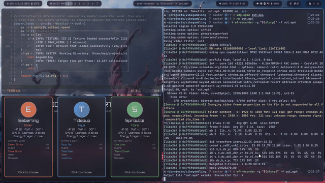

# Monster Colony

A hex-crawl **colony builder** set in an infinite underground. Build a colony on
procedurally generated terrain, feed and defend your monsters from roaming
wilds, and settle fights in a symmetric **deck-builder** battle engine.

Built with [Odin](https://odin-lang.org/) and [raylib](https://www.raylib.com/).

## 🎬 Demo



▶️ **[Watch the full-quality `out.mp4`](out.mp4)** (48s, 1080p)

## Build & run

You need **Odin** with its bundled raylib bindings (and the usual raylib system
deps). Then:

```sh
make run     # compile & play
make build   # build bin/monster-colony
make check   # type-check only
make clean   # remove bin/ and build/
```

### Play in the browser (WebAssembly)

The game also builds to WebAssembly. This needs [Emscripten](https://emscripten.org/)
(`emcc`). Easiest:

```sh
EMSDK_AUTO_INSTALL=1 make web   # downloads emsdk into ./.emsdk, then builds into build/web/
make serve                      # builds, then serves http://localhost:8000/
```

If you already have Emscripten, just `make web` (or `EMSDK_DIR=~/emsdk make web`).
The build script looks for `emcc` on `PATH`, then `$EMSDK_DIR`, `~/emsdk`,
`~/.emsdk`, `/opt/emsdk`, `/usr/local/emsdk`, and `./.emsdk`.

WASM can't be loaded from `file://`, so serve `build/web/` over http (any static
host works — GitHub Pages, itch.io, `python3 -m http.server`, …). The build
script fetches the raylib web library into `web/lib/` if it is missing.

### Controls (colony)

| Key | Action |
|---|---|
| Left click | move to an adjacent tile / select a monster (click again to cycle stacked monsters) |
| `Tab` | cycle through your monsters |
| `Space` / `E` | end turn |
| `B` | build / repair / replace improvements |
| `T` | Trading Post (when standing on one) |
| `V` | view a monster's deck & item |
| `M` | monster encyclopedia |
| `I` | improvements dex |
| `G` | item bag |
| RMB / `WASD` | pan, wheel to zoom |

Battles are played with `1`–`5` / clicks to play cards, `E` to end your turn, and
`C` to use a capture card.

## Design & code docs

- [DESIGN.md](DESIGN.md) — the design spec, systems and phased roadmap.
- [docs/](docs/README.md) — a code guide for modifying the game: architecture,
  the colony layer, the battle engine, content tables, UI/input, and a
  recipes/gotchas/hacking guide.
